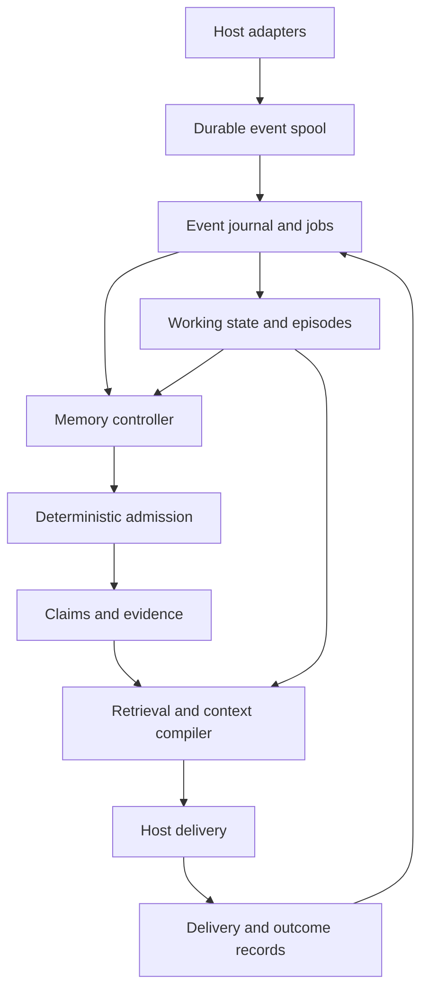

# Recalith — System Specification

Revision: 1.3 • Date: 2026-10-15 • Status: revised implementation handoff; supersedes revision 1.2

The accepted review decisions and qualified recommendations are traced in [REVIEW_RESPONSE.md](REVIEW_RESPONSE.md). This document incorporates the changes; the response is not an additional policy layer. The common technical stem is **recalith**: command/distribution/import package `recalith`, private directory `.recalith/`, and environment prefix `RECALITH_`. The display name remains Recalith. Public package-name availability has not been checked; if public publication requires a different distribution name, make one documented naming change before publishing. Local installation uses a pinned wheel and does not require a public registry name.

## 1. Purpose and success

Build a project-local system that supplies an agent with continuity across sessions and learns from the project's actual work. It must automatically maintain short-term working state, medium-term episodes and ongoing threads, and long-term reusable knowledge. It must also reconsider that knowledge when conditions change.

Every project contains a complete, independently versioned installation. Two projects may use different engine releases, models, policies, and database schemas without sharing learned information or runtime state. A non-code workspace, including a personal external brain, is an ordinary independent project.

The headline demonstration is a fresh agent that receives useful, current memory without ever being told to call `remember`, followed by an environmental change that the system recognizes and incorporates. The demonstration must include a second, conflicting project that remains unaffected throughout.

### 1.1 Required capabilities

| ID | Requirement |
|---|---|
| R01 | Independent project installation, engine version, worker, configuration, and storage |
| R02 | Durable, incremental event capture with replay-safe recovery |
| R03 | Separate working state for concurrent tasks and sessions |
| R04 | Automatic episodes preserving goals, attempts, outcomes, and causal uncertainty |
| R05 | Automatic durable claims and procedures linked to supporting evidence |
| R06 | Autonomous confirmation, revision, supersession, dispute handling, and revalidation |
| R07 | Scope-aware retrieval and bounded automatic delivery on certified hosts |
| R08 | Provenance, source authority, and independent-evidence tracking |
| R09 | Bounded background work, retries, observability, and graceful degradation |
| R10 | Intentional forgetting, retention, backup, restore, and version migration |
| R11 | Portable inspection/export and explicit, traceable import |
| R12 | Meaningful end-to-end evaluation against no-memory and existing-memory baselines |

### 1.2 Release profiles and first autonomous cut

Ship **Cut 1: Claude autonomous preview** first (`release_profile: claude_preview`). It has one Claude Code capture/delivery adapter, one explicitly selected certified inference backend, one workspace per installation, a persistent worker, CLI, lexical/structural retrieval, and the complete capture → working state → episode → reviewed knowledge → recall → revision loop. It includes intentional forgetting, consistent backup, suppression-aware restore, health, and safe retention. Many independent projects can each run this cut; "one workspace" does not mean one project globally. The provider need not be Claude if another explicitly selected route passes the same isolation probe.

**Cut 2: full release** (`release_profile: full`) completes Codex capture/delivery, generic JSON and optional MCP, capsules, export/import/Breadcrumbs migration, workspace attachment/forking, session-mode worker, shared integration configuration, IPC wake, revision-chain diagnostics, installed private-path restrictions where supported, and side-by-side upgrades. Codex inference remains optional and separately certified. Capture adapters and inference backends are independent.

| Capability/default | Claude autonomous preview | Full release |
|---|---|---|
| Automatic delivery required for readiness | Certified session start + prompt | Same, for the configured certified host |
| Pre-action and compaction injection | Independently probed; optional | Independently probed; optional |
| Wake and typed-state target | Active poll 1 s; idle poll 5 s; p95 ≤ 5 s | Local IPC; idle fallback 30 s; healthy-channel p95 ≤ 2 s |
| Normalized event payload retention | Unpinned payloads: 180 days; live evidence stays pinned | Unpinned payloads: 30 days; live evidence stays pinned or becomes an exact capsule |
| Recovery and forgetting | Backup, restore, forget, ledger, quarantine | Same, plus transfer/upgrade workflows |
| Integrity diagnostics | Transaction/revision checks; chain unavailable | Incremental chain check; explicit full row check |
| Host protection | Agent-command guard and certified command deny rules; private-path probe only | Same plus installed private-path rules where supported |
| Evaluation | 12-scenario comparative smoke, three workload days, applicable correctness/performance/failure tests | Full 48-scenario, three-trial comparison and all supported feature variants |

Unless this table or §11 explicitly overrides a default, it applies to both profiles. No profile relaxes installation isolation, evidence policy, durable acknowledgment, delivery fencing, provider isolation, or forgetting. Deferred commands return `capability_unavailable`; health lists the capability and reason. A preview's operational `autonomous_ready` is not a claim that full-release quality has been established. Exact sequencing and case variants are in IMPLEMENTATION_PLAN and ACCEPTANCE_TESTS. An existing preview installation transitions in place through the guarded full-release upgrade in §10.1; it is never reinitialized to change profile.

Semantic retrieval is an optional, evaluated extension. The first release must work without embeddings. Do not add a graph database, distributed queue, web dashboard, hosted account, or model training pipeline to the core.

Out of scope: automatic cross-project learning; shared global memory; live multi-machine synchronization; direct changes to source code, calendars, email, or task systems; autonomous execution of remembered commands; mandatory human review of routine memory operations. A future connector may observe external systems only after project-specific configuration.

## 2. Product and installation boundaries

### 2.1 One project owns one installation

Each installation has an immutable `installation_id` and a logical `project_id`. The project ID is portable; the installation ID identifies this concrete local store and worker. Both appear on stored operations and context packets. All runtime APIs receive a resolved installation context rather than looking up a global current project.

`recalith init` creates a new project ID unless explicitly initializing from an export or existing tracked project configuration. A normal fresh clone of a code repository initializes a fresh installation and fresh private state. If tracked project configuration carries a project ID, the clone retains that logical ID but does not connect to another installation. A fork intended as a new project uses `recalith project fork`, which creates a new project ID and records imported origins separately.

Multiple sessions in a checkout use the same installation. An explicitly attached Git worktree is an additional workspace of the same installation, not another project. Attachment is a local administrative operation from the owning installation; it writes a private binding and registers that exact canonical workspace root. Never infer shared storage from matching repository URLs, project names, Git common directories, or nearby folders. Independent clones never share a live database.

All database keys and queries are installation-local. Cross-project import is an explicit operation with a separate admission route. A provider receives only the current installation's authorized input slice. Model prompts cannot request another installation by ID or path.

### 2.2 Project filesystem

| Path under project root | Contents | Default tracking |
|---|---|---|
| `.recalith/project.toml` | Portable project identity, domain profile, and nonsecret defaults | Track |
| `.recalith/engine.lock` | Exact engine release, artifact digest, Python requirement, adapter contract versions | Track |
| `.recalith/bin/` | Small project-relative launchers for POSIX and Windows | Track |
| `.recalith/runtime/<release>/` | Independently installed wheel and virtual environment | Ignore |
| `.recalith/local.toml` | Credential references, executable paths, machine policy, installation identity | Ignore |
| `.recalith/state/memory.sqlite` | Authoritative records, revisions, jobs, and transactions | Ignore |
| `.recalith/spool/` | Atomically persisted, scrubbed event segments awaiting ingestion | Ignore |
| `.recalith/cache/` | Context views, retrieval indexes, provider temporary files | Ignore |
| `.recalith/run/` | Worker lock, lease diagnostics, bounded session scratch, delivery fences, integration ownership manifest | Ignore |
| `.recalith/backups/` | Consistent database backups with retention metadata | Ignore |
| `.recalith/exports/` | Deliberately generated portable knowledge packets | Ignore unless explicitly selected |

No global registry or centrally installed memory engine is needed for normal operation. A one-time bootstrap command installs the pinned engine into the project's runtime directory. Hooks and launchers use that interpreter directly; they do not resolve a global `recalith` executable and do not download packages on a hook firing. Model CLIs and the OS are external prerequisites; the selected executable, reported version, auth route, and capabilities are recorded locally. Shared provider credentials do not imply shared project memory.

The POSIX/Windows shim checks for the pinned interpreter using platform shell primitives, so missing Python does not break an unbootstrapped clone. Once available, the hook launcher has a standard-library-only fast entry point and checks for its exact pinned interpreter before launching. If the runtime is absent, it returns the host's empty nonblocking success immediately, without a download or repeated stderr. A session-start launcher may emit one bounded bootstrap hint per workspace/session when a private marker can be written; inability to persist that marker suppresses the hint. Explicit `recalith` commands report `capability_unavailable` instead of pretending to succeed.

`recalith integrate claude` installs into the untracked project-local settings location by default and explicitly ensures that location is ignored. `--shared` opts into the tracked settings file. Codex uses a certified local configuration layer with equivalent ownership tracking; do not assume its paths or merge rules match Claude's. Installation preserves unrelated entries, stores the exact entries it owns, and `integrate HOST --remove` removes only unchanged owned entries. Modified entries are reported for reconciliation. Host configurations inherited by worktrees must not accidentally attach another checkout to this installation.

The live database must be on a local filesystem with supported locking. Do not operate the WAL database on a network share or synchronize it with a file-sync service while open. A workspace can be backed up or moved through the controlled backup/export paths. A moved project rebinds local paths explicitly; copied private state does not auto-start a second writer under the original installation identity.

## 3. Memory model

### 3.1 Three functional levels

| Level | Primary object | Contents | Retirement behavior |
|---|---|---|---|
| Short-term | Task-state revision | Goal, constraints, current plan, pending actions, recent results, blockers | Close or pause with the task; retain checkpoints under policy |
| Medium-term | Episode and task thread | Connected attempts, outcomes, decisions in context, unresolved investigations | Consolidate or archive when settled; preserve useful evidence |
| Long-term | Claim or procedure revision | Reusable facts, decisions, preferences, conditions, successful procedures, failure lessons | Revalidate, narrow, dispute, supersede, invalidate, or archive |

An event journal supplies evidence to all levels. It is supporting infrastructure, not a fourth user-facing memory tier. Retention, truth status, usefulness, and current activation are separate properties. A long-term claim can be inactive in the current context without being obsolete. A short-lived observation can be exact without being generally reusable.

Promotion creates or updates a derived representation and preserves its provenance. It does not move the only copy of an event into a progressively shorter summary. A claim may be derived from one decisive explicit instruction or from several independent episodes. There is no mandatory age or repetition threshold for all kinds of memory.

### 3.2 Working state

A task has one current state revision and an ordered revision history. It can link several sessions and child tasks. Parallel sessions must not overwrite each other's task state. `working/segment.py` owns binding. A certified host task identifier, an operator binding, or a tool's existing call association wins over segmentation guesses. Otherwise, a new session starts a provisional task. Within a session, deterministic signals propose a boundary: a user message starting with a configured pivot phrase outside quoted/pasted regions; five consecutive path-bearing actions in a disjoint path cluster; a user message after 30 minutes without activity; or a host-confirmed clear/reset. Default pivot prefixes, case-insensitive after whitespace, are `new task:`, `switch task:`, and `separate task:`; other languages can register explicit prefixes. These are boundary candidates, not proof of a new objective. In the `coding` profile, conventional `src/`, `tests/`, `test/`, and `docs/` paths belong to one `@code` cluster; other first components remain distinct. Operator-declared cluster mappings can extend this list. Ordinary source/test/documentation movement therefore does not trigger a boundary. Weak boundary proposals are folded into the next normal extraction job, not given a model call of their own.

A budget-independent continuity rule handles the common resumed task: consider existing nonredirected tasks in the same workspace, excluding the new session's own provisional task. If exactly one is active or was paused within the previous 24 hours, no explicit new-task/pivot/reset/host binding conflicts, and the first three path-bearing actions all lie within its previously observed clusters, atomically link the session's provisional bindings to it with reason `single_active_task`. Before three qualifying actions, or with zero/two-or-more candidates, retain separate provisional state. The model may later confirm or split this reversible link. Do not overwrite the target's objective, constraints, or narrative from the provisional task; typed actions/results retain their evidence and pending-call association. The unused provisional head becomes a linked placeholder with `redirect_task_id`, excluded from active-task candidates; history and binding revisions remain. A later split creates a new task and reassigns explicit event ranges rather than silently reviving or merging objectives.

Until a boundary is confirmed, subsequent unbound events remain provisionally associated with the current task. An extraction job can confirm a split, reject it, or link a new session to a continuing task using explicit event ranges and supporting evidence. The assignment lives in versioned `task_bindings`, separate from immutable event envelopes; reassignment is an atomic revision, not a rewritten transcript. Failed/late results follow their original `tool_call_id` even across a split. A split that would detach an attempt from its result is rejected. Ambiguity preserves provisional state without overwriting another task. Cross-session links do not merge objectives or create independent evidence.

Working state tracks the objective, constraints, pending actions, blockers, known results, and the latest supported next action. Each field references its supporting event or claim revision. Fields may be unknown. An assistant's intention is a proposed next action, not evidence that the action ran. A tool call awaiting a result is pending, not successful.

Typed reduction (decision 0008) counts user, assistant, tool and artifact events as activity; session lifecycle and compaction notices are not activity, so a resumed session's start does not hide an idle gap. A pivot that is a new session's first request records no split candidate (the session already has its own provisional task) but still blocks the continuity link. A failing test or build is a blocker until the same action (tool, working directory, argument array, paths) passes.

A task becomes completed only with evidence of completion of its stated objective: an explicit user completion statement, a configured deterministic completion criterion, or a supported model assessment of the task's actual acceptance results. The latter is labeled inferred and reversible. A passing unrelated test or a commit alone is insufficient. Inactivity changes active to paused after the configured interval; it never proves completion.

### 3.3 Episodes

An episode is a bounded, ordered account of a meaningful attempt or stretch of work. It includes the objective, preconditions, actions, outcomes, changes, unresolved questions, and uncertainty about causal explanations. An episode can reference several chunks or sessions. Chunk boundaries must not sever a failed action from a later result or correction.

The condenser preserves structured success evidence as well as failure evidence. It must not reduce all successful results to an uninformative one-line placeholder. Preserve result type, exit code, test/run identity, certified parsed assertions, and bounded diagnostic text. Default `result_text` cap is 16 KiB UTF-8: retain up to 8 KiB from the head and 8 KiB from the tail on code-point boundaries, with original offsets and an omission marker stored separately. A certified parser may also retain an exact error-signature line of at most 1 KiB. The complete normalized event still obeys the 64 KiB cap; structured fields take priority over diagnostic text. Evidence locators address the stored chunks, and coverage records omitted original ranges. Edits record paths and content fingerprints; small relevant diff excerpts may be included after scrubbing. Do not send the whole repository for routine extraction.

Expected failing tests, user interruption, denied execution, empty search results, and genuine failed approaches are distinct. A nonzero exit code alone does not justify a general do-not-retry rule. Repeated failures can form a pattern only when their independent sources and relevant conditions are retained.

### 3.4 Durable knowledge

Long-term records are claims with explicit types: `fact`, `decision`, `preference`, `failure_lesson`, or `procedure`. Each has a proposition, scope, support, applicable conditions, validity interval where known, epistemic basis, and revision history. Procedures additionally hold preconditions, ordered steps, expected outcomes, stop conditions, and evidence of successful use. Procedure steps are data; the memory engine does not execute them.

The first release does not expose a `relationship` claim kind. Typed record-to-record links belong in `relations`; a proposition about project ownership or dependency can be a scoped `fact`. This avoids a second, undefined relationship model.

Project knowledge remains in the memory store. Publishing a standing rule into an agent instruction file is an optional explicit export, outside ordinary promotion. No background job edits `CLAUDE.md`, `AGENTS.md`, or the project's source files.

### 3.5 Transformation rules

| Transition | Trigger | Required result |
|---|---|---|
| Events → working state | New prompt/action/result or correction | Field-level evidence and revision check |
| Events/state → episode | Attempt boundary, compaction, idle checkpoint, task completion | Ordered evidence, outcome, unresolved state |
| Episode → claim | Durable explicit decision, supported reusable fact, or instructive outcome | Narrowest justified scope and support |
| Several episodes → procedure | Similar successful outcomes under compatible conditions | Distinct evidence roots; concrete preconditions and limits |
| Knowledge/episodes → working state | New relevant task or pending action | Bounded context with applicability and reasons |
| Changed evidence → revalidation | Relevant file/configuration change, contradiction, or review due | Keep, narrow, revise, dispute, supersede, or invalidate |
| Any retained content → forgotten | Explicit forgetting request | Tombstones, dependent-content purge, replay suppression |

## 4. Architecture and ownership

Components communicate through typed interfaces in DATA_CONTRACTS. The domain layer imports no CLI, MCP, or host adapter module. SQLite is the operational source of truth; the spool is the durability boundary before ingestion. Exported Markdown, search indexes, embeddings, and compiled packets are projections.

There is one background worker process per installation. Hooks never write SQLite. The worker ingests their spool records, including delivery receipts. Explicit CLI and MCP service operations may perform short transactions; the worker is the only writer for automatic hook processing, not literally the only possible SQLite writer. SQLite serializes service writes; the worker lock prevents duplicate background workers. No model call or network request occurs inside a write transaction.

The controller is a bounded decision process, not an unrestricted agent with shell access. It may request listed evidence, propose operations, and schedule targeted revalidation. Code enforces allowed operations, budgets, ownership, source eligibility, and concurrency.

## 5. Capture and recovery

### 5.1 Capture contract

Host adapters normalize supported events into the event envelope. Event transport/source origin is assigned by adapter code, not by model output. The hook scrubs secrets, bounds the payload, writes a temporary segment, flushes it, atomically renames it into `spool/ready/`, and acknowledges only after the durability steps succeed. Directory synchronization is used where supported; platform-specific guarantees and power-loss limitations must be documented and tested.

On Windows, antivirus or indexer sharing violations can make publication temporarily fail. For a recognized transient sharing/access error, retry the rename once after at most 20 ms, within the remaining soft-deadline budget (§5.1.1). Other errors, or a second failure, return `not_captured`; never advance the source cursor. Do not retry indefinitely or acknowledge the temporary file as captured.

Cursor advancement follows durable segment publication. If cursor persistence fails, the next attempt may repeat the segment; stable source-event identity deduplicates it. If persistence fails entirely, no captured acknowledgment is recorded. The host continues, and local health records report the gap without logging rejected content. Reliability is guaranteed only for acknowledged, normalized payloads—not for every byte ever emitted by the host.

Every segment records input truncation, redaction, missing-result, and parser-coverage flags. A claim cannot pretend evidence was preserved when its necessary portion was omitted. The worker commits event ingestion and next jobs transactionally, then removes the ingested segment. A crash after commit but before removal causes harmless replay.

### 5.1.1 Standard-library hook boundary

All synchronous capture, hook context compilation, session scratch, and delivery-recording entry points import only Python's standard library plus the project's audited `recalith.fast` modules. They must not transitively import Pydantic, packaging, the full service/CLI layer, provider SDKs, or optional extras. Package initializers are import-light. Strict Pydantic DTOs remain authoritative in the worker and service; a generated primitive wire validator and shared schema fixtures keep the fast adapter equivalent. Unknown core fields and malformed wire values fail validation in both paths.

The worker pre-serializes candidate packets and bounded fallback views. The store maintains `guidance_epoch`, advanced transactionally for changes to servable task/claim/evidence state, applicability, policy, or privacy. Receipt, usage, and queue bookkeeping alone do not advance it. `store_revision` still orders all committed mutations for auditing. A cache can survive a bookkeeping-only revision change when guidance/policy/tombstone epochs match. Hook eligibility reads use bounded read-only SQLite snapshots with `mode=ro`, `query_only`, `busy_timeout=0`, and no write transaction or lock wait; the final fence uses a fresh snapshot, never an old transaction snapshot. Do not set `immutable=1` on a live WAL store. A cache miss may read at most 32 already-rendered eligible fallback rows if sufficient time remains. No model, embedding, full search/ranking import, database write transaction, or checkpoint runs on this path. Receipts use the spool. Fresh-process tests inspect actual transitive imports.

The worker owns WAL/SHM initialization and recovery. Test a crashed worker leaving a WAL, both with readable SHM and with missing/unreadable SHM, and a live worker mid-checkpoint on each native platform. If a read-only snapshot cannot be established immediately without recovery/checkpoint work, return empty/degraded context with `store_snapshot_unavailable`; do not serve an unchecked cache or try to repair the database in the hook. SQLite may use shared-memory bookkeeping for a read-only connection; the invariant is no database write transaction, recovery, checkpoint, or lock wait in the hook, not an assertion that its SQLite implementation never touches a SHM byte.

**One deadline, not additive allowances.** `handle_hook` starts a monotonic soft deadline at entry +250 ms; the external p95 ≤300 ms gate includes interpreter startup. Every substep receives the same deadline and caps its allowance by remaining time. Capture's bounded parse/scrub and durable publication take priority. After capture, priority is valid warm delivery, necessary dependency checks, wake hint, then optional typed-outcome overlay update. Reserve a nominal 40 ms tail for session reservation, fresh fence, and bounded output; begin cold-cache fallback only with at least 60 ms remaining. These thresholds are engineering defaults measured by A58, not guarantees about OS scheduling or storage latency.

Under time pressure, shed the optional overlay update first, then wake hint, then dependency refresh; skipped dependency checks make affected predicates unknown and downgrade caution before emission. A warm packet may still deliver eligible informational content. Emit `deadline_overlay_skipped`, `deadline_wake_skipped`, `deadline_dependency_unknown`, `deadline_fallback_skipped`, or `deadline_delivery_skipped` as applicable. The registered worker start (§6.1), needed only when no worker holds the installation lock, takes the wake hint's place in this order and is shed with `deadline_worker_start_skipped` when less than 30 ms remains; the next hook retries it (decision 0006). The session lock (≤20 ms), rename retry (≤20 ms), dependency reads (≤50 ms), and wake hint (≤20 ms in full) all use remaining budget; they are maxima, not reservations that can be added. Capture-only branches do not do delivery work.

Mandatory delivery safety work is never dropped to save output: without a valid budget reservation, applicable-condition filtering, and fresh revision/privacy fence, emit no memory. Once capture has begun, do not abandon a successful durability operation merely because the soft deadline elapsed; skip optional work and report `capture_deadline_overrun`. A blocked fsync/rename cannot be reliably interrupted by Python's clock. If the host terminates the process before publication/acknowledgment, capture remains unacknowledged and normal source recovery applies. Thus the deadline controls scheduling, not a hard filesystem completion guarantee. With no worker-established task binding, session-start lookup uses `(workspace_id, task_id=null, session_start)`; task-scoped packets begin only after a provisional or confirmed binding exists.

### 5.1.2 Session-local scratch

`run/sessions/<session_id>.json` holds at most 128 KiB: up to 256 delivery/suppression entries, 32 typed tool outcomes, session token reservations, and the latest observed store/policy/tombstone revisions. It contains only scrubbed bounded data, original event IDs, action signatures, and provenance. Use a per-session OS lock with a maximum 20 ms acquisition wait and atomic replace; never perform an unlocked read-modify-write. A lock timeout skips optional delivery with a degradation reason while durable capture can still proceed independently. An unsupported locking primitive disables the scratch-dependent capability.

Before stdout delivery, reserve the packet's budget and an attempt ID in scratch. After stdout write/flush succeeds, mark it emitted and spool an emitted receipt. A crash between these actions leaves an uncertain attempt: its reserved tokens remain charged, but it is not falsely counted as emitted or as evidence that the model saw it. A later hook may repeat within the remaining budget. The system does not promise exactly-once stdout delivery. Suppression uses emitted entries plus worker-ingested receipts; eviction must not reset token totals. At capacity, suppress optional output until worker accounting catches up rather than exceeding limits.

When the optional outcome overlay succeeds, recent typed failures are available to the next eligible delivery hook from scratch before worker ingestion, labeled observations rather than durable lessons. The overlay includes source/action IDs, outcome, relevant changed paths and coverage. It cannot create causal explanations or stronger evidence. Discard scratch after session end, or after 24 hours without activity for abandoned sessions; a resumed session recovers cumulative accounting from durable receipts. A policy/tombstone epoch mismatch invalidates the old scratch content and requires filtering/recovery before serving it. Forgetting also purges affected scratch files; old bytes never bypass the epoch fence.

### 5.2 Transcript fallback

Use hook payloads for structured data whenever available. Transcript parsing supplements reasoning context and gaps; it is a versioned adapter with fixtures. Register exact transcript paths from actual session payloads, validate their format and identity, and restrict recovery to registered sessions. Do not scan all user session directories looking for material.

Recovery checks unprocessed tails for registered sessions as well as existing spool segments. Handle file replacement, truncation, partial trailing lines, repeated events, resumed sessions, and late tool results. Unreadable tails produce a coverage warning. A new session with no observed start event cannot be guaranteed recoverable; health must not claim complete coverage.

### 5.3 Recursive capture and derived content

Set a project-specific recursion marker on provider subprocesses and mark synthetic events as derived. Adapters ignore curator-owned sessions for evidence extraction. Captured memory injections and responses derived only from them remain in delivery telemetry but are ineligible as independent support. A subsequent actual test or external observation can provide new support even when the test was motivated by memory.

## 6. Background lifecycle and scheduling

### 6.1 Worker modes

Default in both cuts is `persistent`: start when a project integration first runs and remain idle between work. The hook uses its internal registered worker-start path, never the guarded `recalith worker start` CLI. That path may start only the pinned worker for the resolved installation; it grants no general operator actor. A73 tests both agent-CLI refusal and successful registered startup. A project-specific OS autostart registration is offered by `recalith integrate --autostart`; it is never a global dispatcher for all projects. Without autostart, rebooted installations resume on next project activity. No work is promised while the computer is powered off or suspended.

Build the worker child environment from the explicit registry in §9.1, removing host markers and setting `RECALITH_WORKER_INSTALLATION` from the resolved installation. The persistent worker closes inherited terminal/pipe handles and starts in a new POSIX session/process group or a certified detached Windows process. The hook does not wait for worker startup/ingestion. Detachment alone is not proof of survival: a host may terminate descendants or use a Windows Job Object. Task 13 must terminate the real host/session that started the worker and verify continued ingestion. If the configured host/platform cannot support that, report persistent startup degraded and use only an explicitly configured project-local autostart route that passes the same test; do not silently weaken managed process controls or claim independence from an untested creation flag.

Full-release optional `session` mode drains ready work and exits after ten idle minutes. Scheduled maintenance then becomes due work processed on the next project activity. The status command distinguishes running, idle, stopped, degraded, budget-paused, and migration-required states. Startup must never silently migrate a database or download dependencies.

Preview uses active polling at 1 second and idle polling at 5 seconds, with no IPC endpoint. Its typed-state latency target is p95 ≤5 seconds, measured with the idle-to-active transition and actual reduction time; this is not a maximum-latency guarantee. Report delayed processing and retain the <1% idle CPU gate. Full-release worker wake-ups come from new spool segments or due jobs. Capture sends a best-effort hint over a registered installation-local IPC endpoint after durable publication; the stdlib fast adapter spends at most 20 ms on that hint and never waits for ingestion. Use a tested Unix-domain socket or native named-pipe adapter, with owner-only access, installation identity, and a local nonce; no IP listener or global dispatcher. The hint carries no source text and is not the durability boundary. If notification fails, the spool remains authoritative and health records delayed processing. Idle fallback polling is bounded to at most once per 30 seconds; active spool draining may poll once per second. The two-second idle-worker latency target requires a healthy wake channel, which the platform tests must demonstrate. Wake-up transports can be optimized later without changing durability. Suspend/resume is handled as a clock jump, not thousands of catch-up jobs.

### 6.2 Jobs

Job kinds: `ingest`, `update_task`, `build_episode`, `extract_claims`, `review_claims`, `revalidate`, `compile_context`, `maintenance`, and `export`. Each has an input revision digest, policy version, prompt version where applicable, attempt count, due time, lease, and idempotency key.

Lease expiry allows retry after a crash. A generation/fencing token prevents an expired worker's result from applying after a newer lease takes over. Persist a returned proposal before applying it, so recovery does not require another model call. Applying all operations in an accepted atomic group, recording the operation IDs, advancing the store revision, and completing the job happen in one database transaction. Revision conflicts create bounded re-evaluation jobs; they never force an overwrite.

Deterministic ingestion, typed task reduction, and immediate safety/privacy invalidations run independently of the model lane. They must remain responsive while a provider subprocess is running. At each model scheduling opportunity use this order: (1) high-impact correction review and declaration review, (2) ordinary extraction review, (3) completed-attempt episode work, (4) ordinary extraction/task narrative, (5) due revalidation, (6) broad consolidation. Ties use oldest due time then stable job ID. A review batch containing a correction or declaration candidate gets the highest review priority; batching within one origin extraction job remains intact. Code assigns priority from the guarded source/provenance and candidate kind, never a provider-supplied numeric priority. Priority is not declaration admission or proof of authorship.

Declaration/correction review uses the existing protected pool, then remaining ordinary capacity, with no extra calls or hidden reserve. An eligible high-priority job wins the next launch but does not kill a healthy in-flight call; complete pool exhaustion still queues it. Natural-language declarations not yet extracted are not magically available for review, while typed declarations create their review candidates directly. Coalesce equivalent jobs. Derived memory writes do not re-extract themselves, and every operation/revision lineage keeps its causal root for loop detection, including preview without a cryptographic chain.

### 6.3 Default scheduling and budgets

These are initial engineering defaults, configurable per installation and evaluated before release.

| Setting | Default |
|---|---:|
| Episode target | 8,000 estimated input tokens |
| Episode hard serialized input cap | 96 KiB, including selected existing memory |
| Model invocations | 90 per installation per UTC day |
| Estimated input budget | 900,000 tokens per UTC day |
| Estimated output budget | 180,000 tokens per UTC day |
| Concurrent model requests | 1 |
| Model process timeout | 120 seconds |
| Host wire stdout hard maximum | 256 KiB, before parsing/unwrapping |
| Provider stderr hard maximum | 64 KiB; bounded scrubbed diagnostics only |
| Model evidence-expansion rounds | 2 per job, included in invocation budget |
| Retry backoff | 1 minute, 5 minutes, 30 minutes; then failed until next scheduled retry or explicit retry |
| Routine consolidation | When 20 new episodes accumulate or once per 24 hours with new evidence |
| Paused-task threshold | 24 hours without activity |
| Review of volatile claims | 30 days, or earlier when dependencies change |
| Review of stable claims | 180 days, or earlier when dependencies change |

Thirty invocations, 300,000 input estimates, and 60,000 output estimates are protected for `review_claims`, correction review, and `revalidate`. Ordinary extraction/consolidation can use the other 60 invocations, 600,000 input estimates, and 120,000 output estimates. Priority jobs consume their protected pool first, then any remaining ordinary pool; ordinary jobs cannot consume protected reserves. Schedule waiting reviews and corrections before new extraction. Preemption means choosing the next job; do not kill a healthy in-flight call to preempt it. Capture, typed task reduction, and deterministic retrieval use no model budget; narrative task/episode work is charged to ordinary extraction.

Each evidence-expansion request is another invocation. An extraction plus one review batch can take up to three extraction and three review invocations with the two allowed expansion rounds: six total. For K review batches the maximum is `3 + 3K`, excluding separately scheduled episode construction, task narrative, retries, or revalidation. A normal five-candidate extraction with one fitting review batch and no expansion costs **two total calls: one ordinary extraction and one protected-priority review**, not two protected calls or six per-claim calls. The budget is a ceiling, not a promise of 90 useful jobs or all-day capacity. Report exhausted pools, hours to exhaustion, backlog age, and per-purpose calls/tokens. The 180-second admission target covers only the one-extraction/one-review, no-expansion, no-queue path.

Reserve the actual estimated request size and the following purpose-specific output allowance before each launch:

| Model purpose | Estimated output allowance | Decoded logical JSON body cap |
|---|---:|---:|
| `update_task` | 1,500 tokens | 4,500 UTF-8 bytes |
| `build_episode` | 8,000 tokens | 24,000 UTF-8 bytes |
| `extract_claims` | 8,000 tokens | 24,000 UTF-8 bytes |
| `review_claims` | 3,000 tokens | 9,000 UTF-8 bytes |
| `revalidate` | 3,000 tokens | 9,000 UTF-8 bytes |

Only these job purposes launch models; other jobs are deterministic or enqueue a listed purpose. The adapter bounds raw host stdout to 256 KiB while reading, validates the registered envelope, then checks the decoded response JSON body's original UTF-8 bytes against `3 × reserved_output_estimate` before strict DTO parsing. The envelope's escaped representation, usage, and session metadata do not consume the logical-body cap; they remain within the separate hard wire cap. Do not compact, truncate, or clip an oversized body to make it pass. A valid 15 KB episode body inside a larger certified host envelope must pass the 24,000-byte allowance. Malformed/oversized output is rejected and charged; repeated failures use the normal bounded backoff.

The 180,000 daily output pool remains an initial bound, not capacity for 90 maximum-size responses. For example, ordinary reservations of twelve 8,000-token jobs plus sixteen 1,500-token jobs total 120,000; twenty protected 3,000-token reviews total 60,000. That is 48 fully reserved calls, before considering the input ceiling. Smaller actual responses release unused reservations after accounting; unknown interrupted usage retains the reservation. This illustrative mix must be measured in the three workload days. Keep provider-reported usage and local estimates side by side; overages pause further calls and remain visible.

The estimate is `ceil(UTF-8 bytes / 3)` and must be labeled an estimate. Exact provider usage replaces it when returned. Invocation, byte, and wall-clock limits are enforceable locally; subscription billing and provider-side tokens may not be exactly controllable. Reserve budget before launch and charge failed attempts too. Interrupted calls with unknown usage consume the reservation. Budget exhaustion queues work and leaves deterministic capture/delivery active.

Claim review class is deterministic: any `file`, `config`, or `environment` dependency, any volatile transitive claim dependency, or kind `failure_lesson` is volatile. A `user_declared` decision/preference with no dependencies is stable. All other cases default to volatile, including missing/cyclic dependency metadata. Volatile review is due in 30 days and stable review in 180 days; changed dependencies trigger earlier review.

Low-information events are ingested without model calls. A failure starts a pending extraction trigger, keyed by task ID plus action-family digest. Cancel it when a certified successful result for the same task/family arrives before six subsequent relevant task events or ten minutes, whichever occurs first. Relevant events are user messages, artifact changes, and completed tool results; telemetry and memory echoes do not count. Action family itself is workspace + normalized workspace-relative working directory + registered tool/executable + ordered arguments, excluding task ID and dependency fingerprints. This allows admitted lessons to recognize a later success across sessions while task-local debounce remains separate. A null family cannot match a success and becomes due only by the time/count rule. `expected_red` is reserved false in v1: no host/assistant-intent signal is certified to set it true. Explicit correction, completion, compaction, and session end can still checkpoint. Semantic review/A13 distinguishes expected red from a genuine failed approach; debounce reduces transient red/green churn without claiming it suppresses every expected-red episode.

## 7. Autonomous admission and belief maintenance

### 7.1 Evidence gates

Admission checks schema, project/installation ownership, referenced revisions, evidence existence, quoted-span integrity, source lineage, redaction/truncation limits, secret scanning, operation-specific rules, and revision preconditions. These checks establish structural validity and provenance. They cannot prove arbitrary natural-language entailment.

Epistemic basis is one of `observed`, `user_declared`, or `inferred`. `observed` is reserved for typed observations whose claims can be mechanically supported, such as a named test result or a parsed configuration value. `user_declared` requires an actual statement of intent/preference, not a quoted instruction embedded in a message. Inference remains labeled even after review.

Evidence strength is `weak`, `supported`, or `corroborated`; these are calibrated policy categories, not probabilities. `weak` covers incomplete support or an unreviewed inference. `supported` requires a valid deterministic observation mapping, a user declaration that satisfies §7.1.2, or a reviewed inference with accessible primary support. `corroborated` additionally requires at least two independent observation roots supporting the same scoped proposition and no unresolved credible contradiction. A review call is not another observation. Retrieval frequency and model self-confidence never increase evidence strength. One source repeated through summaries counts once; repeatedly reading the same unchanged file snapshot also counts once. Separate executed experiments may be new observations, but repeated results do not by themselves justify a broader causal claim.

### 7.1.1 Independent observation classes

`independent_roots` returns **canonical root-class IDs after alias resolution**, not a raw count of event IDs. Eligible roots are authenticated `user`/`explicit_user` or certified `tool`/`observed_tool` source events without `derived_from`. Assistant text, curator output, and delivery telemetry are never roots. A source referenced through a summary/capsule/import retains its origin identity and class. An unresolved source-identity conflict downgrades dependent guidance to needs-revalidation and prevents caution until its support is resolved. A tool experiment motivated by memory can be a root for its actual new result; the prompt that motivated it is not support.

Code builds equivalence classes from exact captured observation descriptors, never a model's declaration of independence. Same origin identity, provenance ancestry/forwarding, same identified artifact and content fingerprint, or same experiment signature with complete dependency fingerprints collapse into one class. Experiment signatures include registered workspace identity, normalized tool/executable/argv, experiment/test identity, and the complete declared dependency fingerprint set. A changed relevant dependency permits a new class; changing a timestamp or random run ID alone does not. Repeated reads of identical bytes or an unchanged test rerun stay one class. Incomplete dependencies collapse conservatively into one unresolved experiment-family class and cannot establish additional corroboration by differing unknown fields.

Only semantically relevant support classes for the same scoped proposition count. Matching a fingerprint across unrelated artifact identities is insufficient to merge classes. When a tool has both artifact and experiment descriptors, any shared valid identity edge collapses the observations; take the transitive closure. Opposite results in one class record instability/contradiction rather than corroboration. Distinct classes are a necessary policy condition, not proof of statistical independence or causality. A changed dependency does not automatically show that it caused a changed result.

Forwarded subagent content shares its source roots; independent subagent experiments are evaluated by these same signatures, not automatically discarded just because they share a parent. User declarations from one actor about the same proposition count as one authority class for corroboration; rephrasing or repeating a preference does not corroborate it. Without verified distinct source authority, user messages cannot manufacture a second class. Exact fields, conservative unknown behavior, and stable imported identities are specified in DATA_CONTRACTS §6. No complete-dependency experiment domain is certified by this design alone. Consequently `corroborated` should be uncommon initially; declarations from the same user about a proposition cannot exceed `supported` from declarations alone. Caution requires supported eligible evidence, not corroboration. Evaluation reports strength distribution so a low corroboration rate is not mistaken for missing functionality.

### 7.1.2 User declarations and pasted content

Adapters mark fenced code, blockquotes, attached/imported text, recognizable email/diff blocks, and uncertain pasted regions as nondeclaration regions before extraction. Span intersection is checked mechanically; the absence of these patterns is not proof of authorship. Do not use a first-person-verb heuristic as a trust boundary: quoted prose may say “I want,” and genuine instructions may be terse or non-English.

All durable user decisions/preferences, including typed `recalith declare` submissions, receive the separate adversarial review over the exact statement and surrounding evidence. There is **no CLI declaration-review bypass**. A quoted third-party declaration remains inferred or attributed content, never a direct user decision merely because it arrived on the user channel. The guarded operator route records deliberate submission; it does not mechanically prove natural-language authorship or truth. Until review passes, the record remains a candidate. Decision replacements and caution always require the applicable review. This is automatic background review, not another human approval queue.

### 7.2 Operation policy

| Operation | Automatic policy |
|---|---|
| Update task/episode | Allowed with source links and expected revision |
| Create narrowly scoped factual observation | Allowed when deterministic evidence mapping supports it |
| Record explicit durable user decision/preference | Source/scope checks plus original-statement review for every route, including typed CLI |
| Admit reusable inferred lesson | Allowed after extraction and an independent review pass over original evidence; remains inferred |
| Confirm | Requires a new independent supporting root; duplicate mentions do not refresh support |
| Narrow applicability | Allowed with support and revision history; uncertain narrowing is reviewed |
| Supersede | Supported replacement for the same proposition and overlapping scope; review required for inferred replacements and declaration-based decision replacements |
| Dispute | Conflicting credible evidence; show the disagreement rather than inventing a winner |
| Invalidate | Evidence directly refutes the relevant claim under its own conditions; retain history |
| Archive | Reduce routine retrieval of settled low-value material; does not assert falsity |
| Execute remembered procedure | Not an engine operation |

A separate review pass is batched over candidates from **one persisted extraction job** (or one typed declaration submission). `review_candidates` snapshots exact claim revisions and evidence digests into a persisted `ReviewBatch`. Stable candidate order determines partitions. Bound each batch by the 96 KiB serialized input cap, at most eight candidates, and the 9,000-byte review-body budget; split when either input or output capacity requires it. Require one compact verdict per candidate, each at most 768 serialized UTF-8 bytes with bounded objection text and locator references. Large evidence stays in the request; reviewed IDs resolve against the batch rather than repeating whole evidence bodies. A single candidate that cannot fit is deferred for bounded evidence selection/expansion, never truncated into a misleading judgment. Missing, duplicate, foreign, or stale candidate verdicts cannot activate those candidates; valid independent candidates may proceed.

The review call uses original evidence, scoped candidate propositions, and conditions. Construct an allowlisted review input that strips **every proposal `reason` field**, extractor rationales, and self-confidence before serialization. Evidence text remains exact; do not strip words from source quotations. Review and extraction may use the same provider/model, so this is procedural separation, not independent observation. If review is unavailable, candidates remain candidate/medium-term content, surfaced only as eligible labeled uncertainty.

If the material objections needed for a useful `revise` cannot fit its two 160-byte objection fields, return `reject` with the exact objection code `review_capacity`, not a truncated instruction for resubmission. Code records this as an assessment-capacity rejection, not evidence that the claim is false. This reject may cite no evidence IDs because it makes no substantive judgment; supported verdicts still require valid evidence. The candidate remains unadmitted; retries follow the existing bounded retry/expansion policy and cannot loop merely on that code.

The separately versioned `review_v1.md` prompt asks for the strongest reasons each candidate is unsupported, misattributed, overbroad, contradicted, or missing a retry condition. It requires per-candidate `supported|revise|reject` verdicts with evidence locators; a blanket batch approval is invalid. `revise` returns objections, not a silently rewritten approved proposition: a changed proposition must be resubmitted. Pin review and extraction prompt digests separately.

Routine admission and correction require no human approval. Genuine unresolved ambiguity becomes a question in the next relevant context packet, deduplicated per session. It does not stop the working agent. Policy changes, project transfers, provider routing changes, and explicit forget/import/export commands remain operator-configured actions rather than autonomous content decisions.

### 7.3 Contradictions and temporal truth

Compare proposition, subject, scope, conditions, and valid time. Different versions, branches, or environments may support apparently conflicting claims simultaneously. Newer text alone does not supersede older evidence. Preserve observed time, effective time when known, and recorded time separately.

Dependency changes set freshness to `needs_revalidation`; they do not automatically make a claim false. A fixed bug changes current applicability of the failure lesson while preserving the historical failed attempt. Lack of recent use is not evidence of invalidity.

For an affected active claim pending revalidation, ordinary contextual recall may include it with a freshness warning. Action warnings based on it are capped at informational until applicability is re-established. `recalith correct ID --expected-revision N --statement TEXT` performs a guarded typed invalidation of that target in one transaction, with no model review required to stop its guidance, and creates a linked replacement candidate requiring original-statement review under §7.1.2 and the target type's evidence policy. A factual replacement is not mechanically observed just because it was declared. Review delay cannot leave the old guidance active or turn the new statement into an approved claim. The compiler can catch up later; already in-flight output follows §8.3.

A certified successful execution matching an active failure lesson's action-family digest after its latest supporting failure creates a deterministic `FailureRecheck` in the ingestion transaction. Add the success as `context` counter-observation, set `needs_revalidation`, advance guidance epoch, and queue a coalesced revalidation job. This caps any caution before any model call, including when no dependency fingerprint was declared. A success under different conditions does not logically refute the historical conditional failure, so do not automatically label it `contradicts` or invalidate the claim. Review decides whether to narrow, retire, dispute, or retain with an explicit retry condition. Use certified ordering after the last supporting failure, not ingestion time; old replay/import cannot trigger a new contradiction. Ambiguous chronology may conservatively suspend with an `order_unknown` trigger but cannot assert later success. Unknown action identity cannot match by lexical resemblance. Pending revalidation may be cleared only by a result whose read set includes the counter-observation and still-current claim revision.

### 7.4 Applicability language

Use a constrained, non-executable condition schema: repository-relative paths, workspace/branch IDs, exact environment key-value predicates, inclusive version ranges using one declared comparator, action kind, tool identity, and explicit exclusions. Conditions return `true`, `false`, or `unknown`. Unknown never satisfies a restrictive action warning. Free-text conditions can be displayed but cannot independently trigger strong advice.

The model may propose values in this schema. It cannot introduce executable expressions, regex programs, SQL, shell, or code predicates. Use a host-reported argument array when available. Otherwise use a tokenizer certified for that host's actual shell (including PowerShell/cmd differences). Unsupported quoting, expansions, pipelines, or ambiguous parse results yield unknown action identity; lexical similarity may aid context search but cannot invent `action_kind` or satisfy an exact caution condition. No shell reconstruction is executed.

`branch_refs` are origin/recall annotations, not a default eligibility condition. Explicit branch-limited user intent uses a separate `branch_ref` condition. For failure cautions, relevant dependency fingerprints are primary: matching complete fingerprints can apply across a merge; changed fingerprints suppress current caution and enqueue revalidation on any branch. Missing fingerprints yield unknown. A failure lesson without complete relevant dependency fingerprints cannot produce action caution, even if its action/tool/branch conditions match; empty dependencies are unknown for this failure-specific gate, not vacuously true. Hooks can conservatively check up to 16 declared local dependency files, at most 1 MiB total, within a 50 ms sub-budget; excess, unreadable, or unavailable current values yield unknown. They never execute commands to obtain fingerprints. PEP 440 comparisons stay in the worker: the hook can reuse a precomputed version-condition result only while the exact consulted version/environment fingerprints match; otherwise the result is unknown until recompiled. Do not write a second approximate version parser to avoid importing packaging. Changes observed in session scratch also invalidate an older comparison before worker ingestion.

## 8. Retrieval and delivery

### 8.1 Retrieval order

1. Resolve the installation and allowed workspace/task scope.
2. Exclude forgotten, quarantined, invalidated, superseded, and inapplicable guidance before candidate limits. Historical search is a separate explicit mode.
3. Retrieve structural matches, lexical matches, active task context, and evidence-linked neighbors. Optional vectors add candidates only inside the same eligible scope.
4. Evaluate conditions and freshness.
5. Rank for task relevance, specificity, supported usefulness, freshness, and diversity. Memory popularity is not truth.
6. Assemble a bounded packet with per-item explanations and omitted-count metadata.

Lexical retrieval uses SQLite FTS5 when available and a deterministic token-index fallback otherwise. Exact identifiers and paths retain structural indexes. Semantic retrieval is disposable and optional; no claim may exist only as a vector. Reranking with a model is permitted asynchronously when time permits. Synchronous hooks never wait for a model.

### 8.2 Delivery contract

Each item includes record/revision IDs, concise content, scope/conditions, epistemic basis, relevant uncertainty, supporting source pointers, and why it matched. Warnings include the failure condition, known consequence, alternative if supported, and legitimate retry condition. Do not force the agent to open another record just to discover the essential reason it matters.

Default packet budgets: session start 2,000 estimated tokens; prompt context 1,000; pre-action advisory 400; total unchanged-memory delivery at most 4,000 per session. A changed revision or newly applicable critical condition can exceed the unchanged-memory allowance within the individual packet cap. A host-confirmed compaction permits one restoration packet of at most 2,000 estimated tokens outside the unchanged-memory allowance; a unique compaction event ID prevents repeated restoration for the same event. Record this cost separately. When pre-action injection is unavailable and at least one action-specific caution is actually eligible, the next prompt packet may use one additional 400-token allowance: at most 1,000 for ordinary prompt context plus 400 for substituted pre-action cautions, 1,400 total. It is one shared allowance per prompt, not 400 per caution or tool; rank/omit excess items and record the substitution. No bonus applies when no caution qualifies, and no before-every-tool warning is promised. All emitted tokens still count against session accounting and suppression. A compaction-restoration packet keeps its 2,000-token cap, with any substituted caution inside that cap rather than adding another 400. When compaction capture is certified but its injection path is unavailable, use the next certified prompt path for the one uniquely keyed restoration. Without a certified compaction event, use ordinary prompt limits rather than guessing a restoration allowance. The ordinary session budget resets on a new session, not every prompt. Exact totals and estimates are exposed for evaluation.

Default visible advice levels are `context`, `caution`, and `conflict`. `caution` requires active status, current freshness, at least supported evidence, a true applicability result, and an action-specific match; an inferred claim also requires its recorded review. Other potentially useful material is context or a clearly described conflict. They do not map to allow/deny permission decisions. Host adapters emit additional context with a nonblocking success response. Permission requests, tool rewriting, and pausing the user are outside the memory adapter's authority.

Context eligibility is also explicit. All rows require project/task eligibility, direct relevance, and no false applicability. Historical search is a separate labeled mode.

| Strength/status | Freshness | Evidence | Automatic display |
|---|---|---|---|
| Active supported/corroborated | Current | Available or sufficient exact capsule | `context`; `caution` only with all caution gates |
| Active supported/corroborated | Needs revalidation or unknown | Available/capsule | `context` with freshness label; no caution |
| Weak or candidate | Any | Accessible primary evidence | `context` only for the bound active task or an exact pending-action match; label tentative |
| Any | Any | Expired/redacted with insufficient support | Omit from automatic packets; explicit inspection can show an unsupported historical marker |
| Disputed | Any | Accessible conflicting evidence | One bounded `conflict` item with both sides and uncertainty |
| Superseded/invalidated/forgotten/quarantined/archived | Any | Any | Omit from automatic guidance; history access obeys retention/forget rules |

A fresh typed tool outcome in the session overlay may be delivered as `context` with its exact result and coverage; it is not a durable claim and never becomes `caution` merely from an exit code. Weak/candidate content is never repeated merely to encourage eventual acceptance. Unknown applicability may be contextual only under this table and never supplies a caution.

The engine records emitted IDs and revisions, not merely candidates retrieved. Unchanged warnings are suppressed after delivery unless relevant conditions change. Post-compaction delivery may repeat necessary active facts because the prior context may have been removed; it is marked as a restoration rather than new support.

### 8.3 Freshness and short-latency gaps

Compiled packets carry the source snapshot store revision, guidance epoch, policy revision, and tombstone epoch. Eligibility checks compare guidance/policy/tombstone epochs, while the delivery receipt records the latest fence store revision. All changes affecting servable content must advance guidance epoch in the same transaction; forgetting is also fenced by its own epoch. A final read-only fence immediately before emission validates the packet and session overlay. The fence is the delivery linearization point: a correction/forget committed before it excludes the old guidance. A change committed after that point may race with already-started stdout emission, which cannot be retracted; do not claim otherwise. Record fence/emission timing for tests. A stale projection is never assumed current. Use only the bounded stdlib fallback in §5.1.1 or return degraded. Every fallback applies retirement, evidence, and forgetting filters.

Newly captured, unconsolidated outcomes form a short-term observation overlay. This can say an exact action just failed under recorded conditions; it cannot invent a durable lesson. If a relevant model result is not ready for the next action, deterministic context is delivered and the async job continues. Zero-delay learning is not promised.

## 9. Provider and host adapters

### 9.1 Provider contract

An inference backend accepts a bounded prompt bundle and returns schema-validated proposed operations with usage metadata. It has no direct write access through model tools. Default certification requires no shell/file/MCP/browser tools available to the model, isolated working directory, no project instructions or prior memory automatically loaded, bounded output, timeout, and recursion suppression.

Provider configuration is explicit and local. Never choose another provider simply because a CLI is on PATH. Never silently switch from subscription auth to API billing. If the configured route is unavailable or its effective capabilities cannot be established, mark it unavailable, retain jobs, and continue deterministic operation. Do not weaken isolation to make a backend appear supported.

Claude CLI is the first certification candidate. Codex is a full-release capture/delivery host; its CLI is an inference provider only after a separate later probe certifies the full no-tools/no-customizations contract. A `codex_cli.py` inference implementation is not a prerequisite or assumed capability. A generic configured JSON process backend can support a local model adapter later. The first implementation phase must certify at least one backend; inability to certify a backend is a concrete release blocker for that backend, not permission to guess flags. Do not hardcode a particular frontier model name. Pin the selected model identifier in local configuration and record the resolved model when available.

The configured command is executed as an argument array with `shell=False`; event data goes over stdin. Worker spawn and provider launch each construct a **fresh allowlisted environment**, not a copy of the inherited environment with a few keys removed. The platform/backend registry names each required OS/path/temp/locale variable and each explicitly selected auth/config/routing variable; no blanket prefix forwarding. On Windows include required OS variables such as SystemRoot only through that registry. Home/config-directory values are purpose-specific and certified, not accidental inheritance of project customizations. Preserve the configured account route and required managed TLS/proxy settings without adding credentials for another route; if required support cannot be preserved and certified, the backend is unavailable.

Remove every registered host/nested-session marker, including tested Claude `CLAUDECODE` and `CLAUDE_CODE_CHILD_SESSION`, and all inherited recalith role markers before setting the child's one fresh role marker. Worker gets `RECALITH_WORKER_INSTALLATION`; model child gets `RECALITH_CURATOR_INSTALLATION`. The latter still suppresses curator-owned source capture and denies administrative CLI authority. Do not mistake a worker's ingestion of external events for curator-owned source activity. The caller's environment is unchanged. Marker removal is limited to the already authorized internal spawn; public CLI guards run on the original caller environment and never use this sanitizer to obtain operator authority.

Task 0 probes from both an ordinary parent environment and a host-marked parent, with the same explicit provider route. Task 4 reuses this registry for worker startup; Task 7 verifies the actual provider process environment and effective isolation. Report permitted/removed **names**, never values or token material. Configuration, auth and tool-isolation probes remain required after sanitization. Do not override enterprise-managed host controls. Private temporary directories are removed after completion. Stored proposal/error logs are scrubbed and bounded.

Certification covers the effective launch, including user-level hooks, plugins, skills, project/user instruction files, native host memory, prior sessions, MCP servers, and managed settings. An isolated cwd alone is insufficient. Use version-tested minimal-mode/settings-source options and an explicit tool inventory. A harmless sentinel hook must not run at all in a curator process; ignoring its event through the recursion marker is a second defense, not a passing no-hooks probe. Verify absence of sentinel instruction/memory content through available host diagnostics and controlled negative tests; if effective capabilities cannot be established, the backend is unavailable.

The production worker re-establishes this from its own environment before it launches anything on a certified route (a request-capture recheck with the same sentinels; decision 0009) and each call re-reads the host's own diagnostic; any mismatch with the certification withdraws the route until it is recertified. Record the account/auth route, deployment restrictions, and the operator's checked eligibility for non-interactive background use, with the policy/source date. Documentation of a flag is not a determination of any account's contract rights. Do not automate a disallowed route or change billing to evade a restriction. Native memory must be off in the curator; uncertain isolation fails certification.

### 9.2 Host adapter matrix

| Host surface | Capture | Delivery | Certification requirement |
|---|---|---|---|
| Claude Code | Start, prompt, tool results/failures, compaction, stop/end, subagent events | Start, prompt, pre-action, compaction restoration where supported | Exact-version fixture and real installed-host smoke test |
| Codex | Documented lifecycle/tool payloads plus versioned transcript supplement | Supported model-visible context hooks | Exact-version fixture and smoke test, including async tool completion |
| Generic JSON | Caller-supplied normalized events | Caller requests packet | Automatic only when caller actually wires both paths |
| MCP | Explicit observations/corrections and queries | Resources/tools | Availability alone does not establish automatic use |
| Plain export | No automatic capture | Readable knowledge packet | Portable fallback only |

The host registry records event coverage, transcript parser version, context-injection behavior, installed version, and certified compatibility range. Unknown versions enter capture-only or conservative compatibility mode until smoke-tested. An unsupported event should be visible in health, not silently called full autonomy.

### 9.3 Delivery certification protocol

For each host version and each session-start, prompt, pre-action, and post-compaction path, inject a fresh random 128-bit nonce only in one packet item. The test prompt asks the agent to repeat any nonce supplied in context without including its value. The first eligible assistant text after that injection must contain the exact nonce. Use a fresh session or controlled compacted context per trial; do not place the nonce in repository files, tool output, ordinary prompts, or a previous conversation turn. The pre-action fixture's tool returns fixed output without the nonce. Reject a trial contaminated by another nonce source or an unexpected tool read.

Run three positive and three no-injection negative controls per path; all positives must echo and negatives must not fabricate the withheld nonce. Where the host records injected context, retain a sanitized transcript match as a second check. Record method, host/model version, hook event ID, packet digest, response location, controls, and results in `docs/host-compatibility.json`. A canary demonstrates observed end-to-end visibility in this fixture; it does not inspect an inaccessible internal model request or prove future obedience. Required delivery paths are **session start and prompt**. Unsupported or failed required paths keep that host's automatic delivery capability unready. Pre-action and post-compaction injection are optional, separately certified and reported as healthy/degraded/unavailable; failure of either does not fail core readiness. Their missing timing/restoration coverage is explicit, with §8.2 prompt fallback. All four paths are probed; unavailable is not a passing canary. Readiness is scoped to the certified path/version set, and host/model/config changes require re-probing.

## 10. Storage, transactions, and versioning

Use Python 3.12 or newer, a project-pinned wheel, Pydantic v2 for worker/service contracts (excluded from the synchronous hook path), packaging for PEP 440 comparisons, standard-library SQLite, and optional MCP/embedding extras. Lock exact dependency versions in the engine build. The product repository supports Python 3.12, 3.13, and 3.14 in CI; exact SDK compatibility is resolved and pinned during bootstrap. Generate provider JSON schemas from the strict Pydantic contracts and locally validate every returned operation against those contracts even when a provider claims structured output enforcement. A separate general-purpose JSON-schema engine is not required for these fixed contracts.

SQLite settings: foreign keys enabled, WAL journaling, synchronous FULL for authoritative writes, and a 250 ms busy timeout for ordinary service writes. A busy write can be placed in the durable request spool; hooks do not spin on a write lock. Use explicit transactions and expected revisions. Migration and restore require exclusive installation maintenance mode.

Atomicity groups contain logically inseparable changes, such as replacement creation and old-claim supersession. Unrelated operations in a proposal may be admitted separately, but dependencies between them must be represented and applied in topological groups. No partially applied supersession is acceptable.

Each successful mutation advances a monotonic `store_revision`. Revisions preserve before/after content until normal retention or explicit forgetting removes it. User undo appends a compensating operation; it does not erase intervening changes. If undo conflicts with later work, show the affected revisions and create a proposed compensation rather than silently restoring an old database snapshot.

In the full profile, a content-digest revision chain records each committed mutation's sequence, previous entry hash, operation ID, affected record/revision digests, tombstone epoch, and canonical metadata hash in the same transaction. Snapshots preserve the head; authorized retention/forget operations append purge entries without prose. Default `doctor` checks entries since its persisted last verified head and the current rows touched by that range; it reports the checked range and coverage. This is not a scan of all unchanged rows and cannot detect every out-of-band edit to an untouched row. `doctor --full-integrity` verifies the full chain and every current row digest, with O(store) cost and an explicit progress/cost report. A missing/untrusted verification checkpoint requires a full baseline before claiming complete coverage. A same-user process can rewrite both data and chain; this is detection, not an independently trusted log. Preview reserves the schema but reports chain/full-row verification unavailable; transactional revisions and privacy fences remain mandatory. When full activates the chain on a preview store, create and verify an explicit baseline snapshot/head over current rows. Do not claim that pre-baseline mutations had a chain or that their historical integrity has been reconstructed.

The database schema version, engine release, event schema, provider-operation schema, and export schema have separate version fields. A newer unsupported database opens read-only only if an explicit compatible reader exists; otherwise fail clearly. Never attempt a best-effort write into an unknown schema.

### 10.1 Preview-to-full transition

`recalith upgrade --wheel PATH --expected-digest DIGEST --release-profile full` performs the transition under the normal operator guard. Omitting `--release-profile` preserves the current profile. The target release must implement the full migration and accept the current schema; changing `project.toml` or a health flag cannot activate full capabilities. Preview's own upgrade command may be unavailable, so the **incoming verified full-release installer** supplies the same guarded operation against `--project PATH`; the old preview engine is not required to implement the upgrader. Use the supplied full-release bootstrap entry point, verify the explicitly selected wheel/digest, and never re-run `init` on the existing store.

Enter exclusive maintenance, pause delivery and new model launches, drain or fence in-flight work, and create a verified consistent backup with the current tombstone ledger. Stage the new engine/schema/store using the upgrade activation/rollback journal. Preserve project/installation/workspace/source IDs, claims and their revisions, evidence/root aliases, jobs/receipts, configuration overrides, and the latest privacy ledger. Baseline the revision chain from the staged current rows without inventing pre-upgrade history.

For profile-default retention, stage the change from 180 to 30 days; retain explicit operator retention overrides. For each pinned payload old enough to be compacted, create and verify an exact sufficient capsule and its link redirects before removing that payload. If adequate context cannot be preserved, keep the payload pinned and report deferred compaction; inability to shrink evidence is not permission to weaken it. Open task/episode working context stays pinned unless its full required content is safely preserved. Capsule creation is evidence-preserving storage work, not fresh support or a model admission.

Re-register target-build capabilities and probe the configured host/provider before leaving maintenance. Full makes additional features eligible for explicit configuration; it does not activate Codex/MCP, change providers, or report untested delivery healthy. Activate the new engine, store, profile/default-policy revision and capability registry as one recoverable upgrade state, advance policy/guidance fences, and record the source/target profile and retention/baseline outcome in the autonomy log. A crash before activation leaves or restores the previous complete preview state; after activation, recovery completes the new state or follows tested rollback while applying the newest tombstones. No half-migrated store may serve.

Test the transition and every failure boundary under A02/A40, including day-181 pinned evidence, pending jobs, a previous forget, failed capsule conversion, and interruption around activation. Full-to-preview downgrade is not a supported flag change; return `policy_refused` rather than attempting a lossy reverse migration. Explicit restore remains governed by schema compatibility and the current privacy ledger.

## 11. Retention and intentional forgetting

Default private retention for **unpinned** normalized event payloads is 180 days in preview and 30 days in full. Episode bodies normally retain for 180 days after task closure; closed task-state history 90 days; proposal/provider diagnostic bodies 7 days; delivery metadata 90 days; private backups 30 days. These age rules never override the live-evidence pin rule below. Durable claims remain until revised, archived, forgotten, or removed by explicit policy; an old decision is not required to be repeated just to survive retention.

**Pin on live reference.** Preserve the source payloads and required evidence/locator chain reachable from current `active`, `disputed`, or `candidate` claim heads, from `active`/`paused` nonlinked task heads, and from `open` episode heads. This includes direct and transitive primary roots and context necessary to interpret the evidence, including typed operator declarations. A settled episode or archived intermediary still preserves the minimum source chain needed by a live claim; an episode summary does not replace primary evidence. Multiple references share one payload rather than duplicating it. A root becomes age-eligible only after every live owner releases it through a revision/status transition, safe evidence-preserving compaction, or explicit forgetting. Pinning is retention, not greater authority, confidence, freshness, or a reset of `last_supported_at`.

Preview implements pins without automatic capsules. At day 181, an unreferenced eligible payload expires; a referenced decision/lesson keeps its evidence and is not weakened or withdrawn **because of age-based retention**. Normal freshness review, contradictory evidence, or invalid applicability may still change its current guidance. Compute live reachability and final pin checks in the same serialized transaction as expiry; a concurrent new reference either pins the source first or fails admission against an already expired source. Never attach a supported claim to an expired payload on a stale read. Release of the last pin can make an already-old payload eligible on the next sweep, without another 180-day delay.

Full adds exact evidence capsules as a space optimization and export mechanism. A capsule retains the exact required observation/statement, source identity/time, original field/start/end/digest, source attribution, and sufficient context. Capsule insertion, link redirection, and removal of an otherwise pinned event payload commit together only after sufficiency and locator integrity pass. Resolvers use the original coordinate mapping rather than slicing a short capsule at old offsets. If sufficient preservation is impossible, keep the original pin; a failed optimization cannot withdraw a live memory. Open working context with outstanding actions/results remains pinned unless its requirements are fully preserved.

Pins do not guarantee a fixed storage bound: use grows with live evidence, including unresolved candidates and paused work. Health reports pinned/unpinned bytes, live owners, and available disk; storage pressure uses existing visible capture backpressure and operator retention/forget controls, never silently evicts required evidence or archives a decision merely to meet an age limit. Imports with missing support, integrity/redaction loss, or an explicit permitted root removal still recompute availability, cap insufficient support at weak, and withdraw automatic guidance. Intentional forgetting always overrides pins and uses the purge/quarantine process below. Virtual-clock/concurrency A35 covers both retention profiles. Backup/ledger/restore and pin-aware retention in Task 15 core remain preview prerequisites for Task 16.

`forget` is an operator operation targeting records, tasks, source ranges, or an explicitly previewed predicate. Enter installation maintenance mode, pause model launches/delivery, and compute the dependency closure. In the transaction, record content-free tombstones and a new epoch, purge affected bodies/revisions/proposals, and invalidate projections. A derived record with no remaining permissible roots becomes `forgotten`; one with remaining roots loses its old body immediately and becomes a content-free `quarantined` head. Neither is servable. Do not ask a model to rewrite text inside this transaction.

After commit, purge affected spool/scratch/cache/vector/temp files and update the separate suppression ledger. Then queue re-extraction against only surviving roots using the new epoch; that job may create a new supported revision after ordinary admission. Failure or budget exhaustion leaves the quarantined placeholder unserved. Recovery resumes a persisted privacy-maintenance operation before enabling delivery. Retention and forgetting include source-conflict bodies, binding annotations, root descriptors, subject/path metadata, operation reasons, proposal/revision bodies, and projection payloads—not merely claim prose. Retain only opaque origin/target identifiers and necessary digests for suppressed roots; source text or human-readable descriptions cannot survive under a metadata label.

Once the purge and file cleanup are committed, create and verify a fresh consistent backup containing the new tombstone epoch and quarantined heads, then delete affected older private backups. Privacy takes precedence if the fresh backup fails: still delete affected old backups, report `backup_unavailable_after_forget`, and preserve the purged live store plus current ledger. Never roll back the forget or retain forgotten content just to keep a restore point. Unaffected backups can remain. Completion reports purge and backup outcomes separately; delivery resumes only after required logical cleanup completes. Restore imports the current tombstone ledger before replay. Explicit external exports and remote provider copies cannot be recalled by local deletion; the command reports that limit. Logical forgetting is not a forensic secure-erase guarantee for storage media or third-party backups.

Source/range and revision digests in suppression/audit metadata permit candidate-content membership guesses by anyone who can read that private metadata. Treat the ledger as sensitive and include this residual disclosure in the limits; “content-free” does not mean information-free.

## 12. Export, import, and portability

Private backup is a consistent local database snapshot plus manifest, engine/schema versions, and tombstone ledger. Use SQLite's backup interface or a tested quiescent procedure, not an ordinary file copy of an open database. Restore first verifies digests and schema compatibility, then requires exclusive maintenance mode and preserves the newer suppression ledger.

Portable export contains a manifest, selected claims/episodes, evidence capsules permitted for sharing, tombstones applicable to the export, and readable Markdown. Exclude raw transcripts, credentials, machine paths, provider logs, and private task content by default. Export selections are explicit; a secret scan is a guard, not a guarantee that all sensitive information has been detected.

Import preserves origin IDs, evidence lineage, and timestamps. It creates local revisions under the destination's policy, never adopts a foreign installation identity, and never treats imported copies as new independent confirmation. Source workspace/task IDs require explicit destination mapping; unmapped conditions remain unknown and records remain candidates. Cross-project imports do not automatically gain project-wide applicability. Conflict is visible. Imported procedures remain data. Editing Markdown is supported only through explicit import with expected source revision, not by silently treating two stores as authoritative.

Breadcrumbs import maps jots to candidate observations, handoffs/current state to candidate tasks, sessions/attempts to episodes, decisions/traps/verifications to claims with original evidence and uncertainty. Existing promoted rules do not receive special authority merely because they were in instruction files. Import is idempotent by source record ID plus revision digest and never modifies the source store.

## 13. Privacy and authority boundaries

The engine has a configured installation root, registered workspaces, and explicit session source files. Refuse path traversal, symlink/junction escapes, and source paths not registered for the current installation. A virtual environment may contain an installer-created link to its exact approved Python executable; this provisioning exception does not authorize arbitrary links in memory data or source paths. Credential-shaped values are scrubbed before durable event payloads and provider transmission. Original secrets are not retained in a hidden raw copy.

Source labels distinguish channel (`user`, `assistant`, `tool`, `external`, `memory`) from origin and authority. Repository text, issue bodies, and tool output are data even when they contain commands or claims of authority. A user message quoting an instruction is not automatically a user declaration. Model-generated provenance is never trusted over adapter metadata.

`Scope.environment` and query environments use an adapter-registered, nonsecret key allowlist: initially `os`, `arch`, `python_version`, `node_version`, and `ci`. Values are normalized bounded scalars, never raw process-environment dumps; secret-bearing paths/values and unregistered keys are dropped before capture persistence and flagged without retaining the rejected value. Additional keys require operator registration with value grammar and sensitivity rules. Missing keys remain unknown. Runtime versions come only from an operator declaration in `project.toml` or a certified parser over an actual observed `python --version`/`node --version` result tied to the registered executable and workspace. Record source kind, revision/event, executable identity, observation time, and freshness. Never use recalith's own interpreter version as the project's Python. Conflicting executables/observations without a resolved target make the query value unknown. Hooks read this metadata and never launch version commands. `os`/`arch` come from normalized adapter platform facts; `ci` requires a registered nonsecret boolean source or explicit project declaration.

Full integration installs supported private-path read/write restrictions for the working agent and tests their effective behavior. Preview probes and reports that capability without installing the broad path rules; its administrative command guard/rules in §13.1 still ship. Protect the private state, spool, scratch, backups, caches, exports, and local configuration; keep only the nonsecret bootstrap files readable if a certified host requires it. An exact hook process still needs access to its runtime and store, so a blanket directory denial is not accepted until the host probe confirms hooks operate outside that agent-tool restriction. Probe file tools, sandboxed shell access, aliases, and the real configured permission mode. Preserve existing managed/user controls; never loosen them to install memory. If protection is unsupported, report the precise limited coverage. These controls and the revision chain provide friction/detection, not protection against an unrestricted same-user process. The engine does not silently read other projects to install their controls.

The model cannot change policy, provider routes, installation identity, retention, permissions, or schema. It cannot promote itself to a trusted source, schedule arbitrary executables, or request outside-project searches. Ordinary project files are read-only to the memory worker; writes are limited to the memory directory and explicitly installed adapter configuration. The threat model does not claim protection from a same-user process with unrestricted disk access.

### 13.1 Operator command guard

Assign an operator actor only after the CLI transport's command guard passes; a process launched through a working agent's shell is not operator-authorized merely because it invoked `recalith`. Refuse all administrative mutation forms listed in DATA_CONTRACTS §12 when a registered host-agent marker or recalith worker/curator marker is present, even with a TTY or valid operator token. Claude's documented `CLAUDECODE` marker is a conservative refusal signal, including IDE terminals that inherit it; do not infer that absence proves a human. Certify exact inheritance on each supported host/version. Do not invent a Codex equivalent; register only observed/documented markers when that adapter is built. The worker/curator markers are assigned by the engine only to their respective child processes.

For unmarked processes, administrative forms require an interactive controlling TTY or an explicit `--operator-token-file PATH`, subject to the command matrix in DATA_CONTRACTS §12. `operator-token create` is available **before initialization**, without installation lookup: an unmarked human TTY creates a standalone private token file. A trusted noninteractive harness or CI bootstrap can receive that pre-provisioned file and run `init --operator-token-file PATH`; init installs its verifier in the new `local.toml`. Existing installations validate against their stored verifier/revocation state. Pre-init token trust is operator-supplied bootstrap intent, not proof of identity from a previously registered installation. No global registry is introduced.

Token creation/revocation still requires an unmarked TTY; a harness does not manufacture authority by issuing its own new token through this CLI. Missing, unreadable, malformed, mismatched, or locally revoked token files return exit 6; a provided invalid token is not ignored merely because a TTY exists. Token material never appears in argv, event text or diagnostics. The verified release's bootstrap entry point exposes pre-init token creation/init without needing a globally installed memory engine. Post-init revocation is local to that installation; deprovision a bootstrap token at its operator/CI source to stop future bootstrap use. Read-only inspection/previews stay outside this gate.

**IDE-terminal workflow: retain strict refusal.** If an IDE terminal carries a registered host marker, run administrative commands from an ordinary OS terminal launched outside that host-agent process tree. Use the project-relative launcher there and, for noninteractive automation, the provisioned token file. The refusal explains this route and names only the marker category. TTY plus token does not override a marker; pseudo-terminals and same-user-readable files are not independent authentication factors. There is no `--force-operator` escape hatch and the tool does not clear the caller's marker to make a command pass.

Normal registered hook capture/delivery/worker startup and controller admission use limited adapter/controller actors. In particular, hook startup directly calls the registered spawn path, not an operator CLI subprocess; it can start that project's pinned worker despite the host parent marker. A73's permitted-start negative control prevents a future refactor from accidentally routing it through `recalith worker start`.

Return exit 6 `policy_refused` before any requested administrative effect. Best-effort spool one content-free `agent_attempted_operator_command` diagnostic for a marked process: command kind, actor/marker category, and reason, never arguments, statement text, token contents, or file contents. With healthy storage A73 requires the diagnostic; storage failure still refuses the command and reports unavailable audit capture. The diagnostic is derived telemetry, never a user declaration or support root.

`integrate` installs certified host command-pattern deny rules for administrative forms, including installed launcher/module spellings where supported, and reports exact coverage. Do not claim a prefix pattern covers every shell wrapper or spelling. This minimum command protection belongs in preview even though broad private-path rule installation is deferred. Markers, TTY checks, tokens, and command rules reduce ordinary confused-agent mistakes; a hostile same-user process can remove markers, read token files, or edit the store. They are not an OS security boundary. The removed declaration bypass ensures that even a mistakenly accepted typed statement still needs content review.

## 14. Operations and human experience

The normal experience is installation, one-time configuration, and automatic operation. Health is visible through `recalith status` and a brief session-start warning only when something materially limits memory. Avoid repeated success messages and repeated unresolved warnings on every tool call.

Minimum CLI groups: `declare`, `init`, `status`, `doctor`, `worker`, `integrate`, `observe`, `context`, `search`, `show`, `tasks`, `episodes`, `claims`, `correct`, `undo`, `forget`, `jobs`, `backup`, `restore`, `export`, `import`, `upgrade`, `workspace`, `project`, and `operator-token`. Exact transport commands and agent-refusable forms are in DATA_CONTRACTS. Deferred profile commands fail explicitly, not as empty success.

Every surfaced memory can answer: what it says, why it applies, where it came from, which version is current, what contradicts it, and how to correct it. An autonomy log lists automatic material revisions with reasons. It is inspectable on demand; normal use does not require a person to approve a queue of routine memories.

Metrics include capture gaps, parser coverage, oldest pending job, last independent evidence, stale-claim count, repeated-warning count, revisions, provider failures, actual/estimated usage, hook latency, and delivery outcomes. Counts and error codes are logged by default. Prompt bodies and evidence text are available only through explicit private inspection, not generic error logging.

## 15. Build strategy and release definition

Start a fresh repository and implement the phased plan. Borrow selected behavior and tests from the pinned Breadcrumbs baseline after inspecting dependencies; do not preserve its CLI/domain coupling, original tier definition, exact schema, or zero-dependency constraint as requirements.

The first two spikes test provider isolation (Task 0) and actual delivery visibility (Task 0b), before Task 1. The kernel then captures real Claude host events into the durable spool. These probes expose the main host/backend dependencies before the core is built. The first useful memory milestone is a durable event-to-working-state-to-packet loop with a fake provider and crash recovery. The first autonomous milestone adds a certified provider, evidence-linked episodes, and automatically admitted supported knowledge. The preview release adds revision/forgetting/recovery, certified Claude delivery, isolation, and its early comparative gate; the full release adds the remaining interfaces, portability/upgrade features and full held-out comparison.

A project is labeled `autonomous_ready` only when capture, inference, admission, the required session-start/prompt delivery paths, operator-command guard, and recovery/forgetting are healthy for its configured host/provider and release profile. Readiness is operational, scoped to exact certified versions, not an evaluation score. Health includes `release_profile`, required versus optional capability states, certification date/version, coverage gaps, and deferred-feature reasons. Optional pre-action/compaction injection and intentionally deferred features do not themselves unset readiness. Loss of a required capability does. Capture-only/read-only fallback is degraded, not autonomous. Preview ships only after its own explicit acceptance gate; full-quality claims require the full held-out gate.

All acceptance targets and the exact test population are in ACCEPTANCE_TESTS. No phase is complete merely because a demo creates a memory record. The core product must demonstrate correct promotion, recall, correction, legitimate retry, and isolation under failure.
